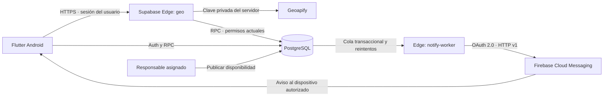

# Integraciones del Sprint 3

La aplicación Android conserva la autenticación, catálogo, gestión de personal, publicaciones y favoritas del Sprint 2. Las HU-11 a HU-15 incorporan preferencias, comparación de recorridos, rutas, avisos y ubicación asistida de estaciones.

## Comunicación cliente-servidor



La disponibilidad procede de publicaciones del responsable asignado. Geoapify calcula direcciones y recorridos; su respuesta no acredita existencias. Los datos de abastecimiento de las cuentas académicas son escenarios de evaluación.

## APIs externas

| Servicio | Método y endpoint del proveedor | Parámetros principales | Resultado utilizado |
| --- | --- | --- | --- |
| Geocoding | `GET https://api.geoapify.com/v1/geocode/search` | `text`, `filter=countrycode:bo`, `lang=es`, `limit=5` | Coincidencias con dirección, latitud y longitud. |
| Reverse Geocoding | `GET https://api.geoapify.com/v1/geocode/reverse` | `lat`, `lon`, `lang=es` | Dirección sugerida para revisar. |
| Routing | `GET https://api.geoapify.com/v1/routing` | `waypoints`, `mode=drive`, `lang=es` | Geometría por calles, metros y segundos. |
| Route Matrix | `POST https://api.geoapify.com/v1/routematrix` | Un origen y hasta 20 destinos, `mode=drive` | Distancias y tiempos por carretera. |
| FCM | `POST https://fcm.googleapis.com/v1/projects/filacero-b94e6/messages:send` | Dispositivo autorizado, título, cuerpo y datos de navegación | Identificador de envío aceptado por Firebase. |

El mapa base usa teselas de Geoapify con atribución a OpenStreetMap y Geoapify. `flutter_map` dibuja el mapa; `geolocator` solicita la ubicación del dispositivo. Estas bibliotecas son componentes del cliente, no sustituyen las APIs anteriores.

## Contrato de la aplicación

Base: `https://oejouwwxngyafftzfkux.supabase.co/functions/v1/geo`.

Las operaciones `POST` requieren `Authorization: Bearer <sesión del usuario>` y cuenta activa. La app utiliza la clave publicable de Supabase. La clave de Geoapify y la cuenta de servicio de Firebase permanecen en el servidor.

```json
{"action":"search","text":"Estación de Servicio Automóvil Club Boliviano La Paz Bolivia"}
```

```json
{"results":[{"lat":-16.5151085,"lon":-68.1198664,"address":"Estación de Servicio Automóvil Club Boliviano, Avenida 6 de Agosto, Municipio Nuestra Señora de La Paz, Bolivia","city":"Municipio Nuestra Señora de La Paz","country_code":"bo"}]}
```

```json
{"action":"recommend","origin":{"lat":-16.50891,"lon":-68.12645}}
```

La respuesta contiene `stations`, `preferences` y `calculated_at`. Cada estación recomendada incluye `id`, nombre, combustible, estado, última publicación, `distance_m` y `time_s`. Se vuelve a comprobar el catálogo después de consultar al proveedor para descartar información vencida, estaciones inactivas y ubicaciones modificadas durante la petición.

```json
{"action":"route","id":"<id de la estación>","origin":{"lat":-16.50891,"lon":-68.12645}}
```

La respuesta normalizada contiene `points` en orden `[latitud,longitud]`, `distance_m`, `time_s`, origen y estación actualizada. La app convierte los datos en modelos de Dart y muestra unidades legibles.

## Reglas y errores

- Preferencias propias: un combustible activo y distancia de 5, 10 o 20 km.
- Recomendaciones: empresa, estación y combustible activos; ubicación confirmada; disponibilidad vigente durante dos horas. Disponible precede a disponibilidad limitada; luego se compara tiempo y distancia.
- La distancia máxima se aplica al recorrido por carretera. Los destinos sin recorrido o con valores nulos se excluyen.
- Ubicar estaciones requiere administrador tanto en la pantalla como en la BD. El formulario guarda estación y ubicación dentro de una misma transacción.
- El cliente elimina resultados anteriores al recalcular, conserva los formularios al fallar y ofrece reintento. El mapa permite recargar teselas que fallen.
- Errores HTTP: `400` datos inválidos, `401` sesión inválida, `403` acceso rechazado, `409` datos cambiados durante el cálculo, `422` sin ruta o ubicación, `429` proveedor ocupado, `502` proveedor o respuesta inválida, `504` tiempo agotado. La reserva diaria también puede rechazar solicitudes al alcanzar el presupuesto compartido.
- Las consultas geográficas tienen tiempo máximo de espera. El servidor reserva menos de 5 solicitudes por segundo y hasta 2500 créditos diarios, con caché acotada de teselas, para mantenerse dentro del plan gratuito de 3000 créditos.

## Avisos

El conductor elige combustible, guarda una favorita y activa sus avisos con permiso de Android. El dispositivo se vincula a su cuenta y sesión actual. Una nueva publicación autorizada de **Disponible** genera un evento solo cuando el estado efectivo anterior era diferente. Activar avisos no reenvía el historial.

`cola_notificaciones` conserva un evento por publicación, cuenta y dispositivo. El proceso reclama filas con bloqueo temporal; Firebase confirma la aceptación antes de marcar el envío. Los fallos se reintentan hasta cinco veces. La publicación de disponibilidad se conserva aunque falle el aviso. Un identificador estable del evento permite reemplazar notificaciones repetidas del mismo envío; el cliente también recuerda eventos ya mostrados.

Antes de enviar se revisan cuenta, sesión, dispositivo, preferencia, favorita, suscripción, actividad del catálogo y disponibilidad vigente. Quitar favorita desactiva la suscripción. Cerrar sesión revoca primero el vínculo del dispositivo; las cuentas no comparten sus avisos.

## Base de datos añadida

| Tabla | Propósito |
| --- | --- |
| `preferencias_conductor` | Una configuración por perfil. |
| `suscripciones_disponibilidad` | Activación por perfil y estación favorita. |
| `dispositivos_notificaciones` | Identificador de mensajería asociado a perfil y sesión. |
| `cola_notificaciones` | Estado de entrega, bloqueo e intentos por evento. |

`estaciones` incorpora coordenadas y confirmación administrativa. Se preservan las claves y relaciones anteriores. Las tablas nuevas tienen RLS y acceso directo revocado a clientes; las operaciones entran por `fc3_query` y `fc3_command`, que verifican identidad y permisos actuales. Las tablas privadas de cuota y configuración del proceso solo se usan desde funciones controladas.

## Configurar otro entorno

1. Crear un proyecto Supabase y aplicar las migraciones en orden. Configurar Auth según el registro académico existente y desplegar `staff-admin`, `geo` y `notify-worker`.
2. Crear una clave de Geoapify y almacenarla como `GEOAPIFY_API_KEY` en secretos de Edge Functions.
3. Registrar Android `com.example.filacero` en Firebase. Actualizar `android/app/google-services.json` y las opciones públicas en `lib/core/firebase_config.dart`.
4. Guardar el JSON privado de servicio codificado en base64 como `FCM_SERVICE_ACCOUNT_B64`. Crear un valor aleatorio de al menos 32 caracteres para `PUSH_WORKER_SECRET`; configurarlo también mediante `fc3_configure_worker`, accesible solo al servidor. Adaptar las URLs fijas de esta migración al nuevo proyecto.
5. Confirmar que HTTP v1 de FCM está habilitado. La cola se despierta al publicar y `pg_cron` revisa reintentos cada minuto.
6. Compilar Android, configurar preferencias y confirmar ubicaciones antes de recomendar. Para la evaluación usar publicaciones recientes realizadas por responsables autorizados.

La credencial privada de Firebase, los secretos de funciones y las cuentas personales no se incluyen en el repositorio ni en el APK. `google-services.json` y `firebase_config.dart` contienen identificadores públicos del cliente.

## Referencias oficiales

[Geoapify Geocoding](https://apidocs.geoapify.com/docs/geocoding/forward-geocoding/) · [Routing](https://apidocs.geoapify.com/docs/routing/) · [Route Matrix](https://apidocs.geoapify.com/docs/route-matrix/) · [FCM para Flutter](https://firebase.google.com/docs/cloud-messaging/flutter/get-started) · [FCM HTTP v1](https://firebase.google.com/docs/reference/fcm/rest/v1/projects.messages) · [Supabase Database Webhooks](https://supabase.com/docs/guides/database/webhooks)
